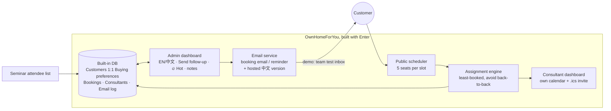

# OwnHomeForYou: architecture (v0.2)

**Slot logic:** a slot is available while `bookings < 5`. To assign a booking, take the free consultants, sort them by bookings that day (ties go C1→C5), and skip any consultant whose booking would be back-to-back when a free alternative exists.

**Capability score:** `min(10, round(20 × income ÷ budget, 1))`. For example, $500k income with a $1M budget scores 10.0, and with a $2M budget scores 5.0.
