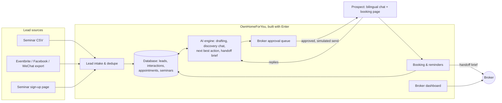

# OwnHomeForYou: architecture

| Part | Built with |
|---|---|
| Web app, database, AI | Enter (Converge.AI) |
| Seminar promo / nurture visuals | Framia (Converge.AI), planned |
| Public sign-up page | Combos / Enter, planned |

**Design principles:** human approval before any outbound message; consent and opt-out gate; AI never gives financial, legal or tax advice; synthetic data only; channel layer simulated so real SMS / email / WeChat can be plugged in later.
